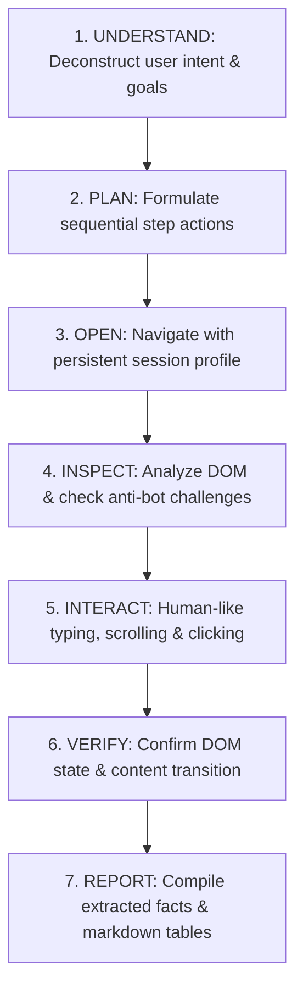

# Advanced Autonomous Browser Agent Report

**Subsystem:** Autonomous Browser Exploration & Extraction  
**Module:** `core/browser_agent.py`, `actions/browser_control.py`  
**Engine:** Playwright Chromium with Persistent Session Context  
**Status:** **OPERATIONAL & VERIFIED**

---

## 1. Overview & Workflow

The Advanced Autonomous Browser Agent enables JARVIS to execute multi-step research, navigation, form-filling, and data extraction workflows autonomously.

### The 7-Stage Autonomous Loop:

## 2. Human-Like Interactions
- **Typing with Jitter**: Key events are dispatched with variable randomized delays (30ms - 90ms) mimicking human keystrokes rather than instant value replacement.
- **Natural Scrolling**: Smooth scrolling increments with `window.scrollBy({behavior: 'smooth'})`.
- **Selector Fallbacks**: Evaluates element visibility and scrolls elements into view prior to dispatching pointer events.

## 3. Strict Anti-Bot & CAPTCHA Safety Invariant
In strict accordance with AI behavioral guidelines:
- The agent actively inspects pages for Cloudflare Turnstile, Google reCAPTCHA, hCaptcha, and challenge headers.
- **Rule**: The agent **NEVER** attempts to solve, click through, or bypass a CAPTCHA or bot check.
- When detected, the agent immediately pauses, logs `PAUSED_CAPTCHA_REQUIRES_USER`, and instructs the user to complete the verification in the visible browser window.
